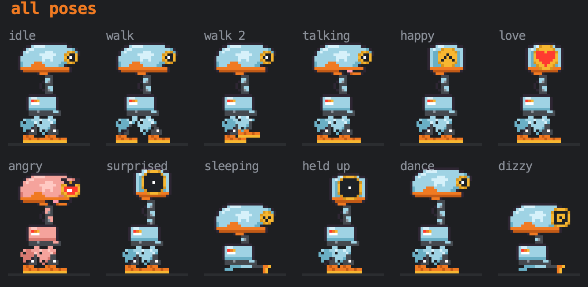
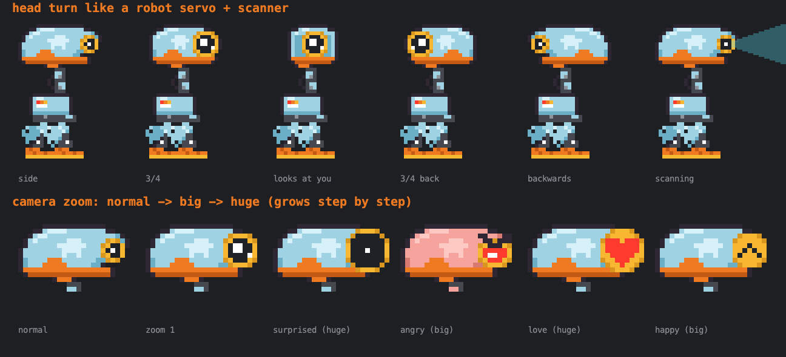

# 🦆 Smart Duck

**A tiny retro pixel-art duck robot that lives at the bottom of your editor and hunts your bugs.**

Smart Duck is a plugin for WebStorm and other JetBrains IDEs. A small light-blue robot walks along the bottom of your code. It reads over your shoulder, dances, naps and scans the screen. When an error shows up, it gets angry and goes after the bug with a laser or a rocket flight.

## The story

For years Smart Duck was an ordinary rubber duck on a programmer's desk. Every night the programmer explained their code to it, line by line, until they found the bug. The duck heard thousands of bugs explained and never said a word.

One day it decided that listening wasn't enough. It traded rubber for a light-blue robot shell, got servo legs, and swapped its painted eye for a **real camera** that zooms in when something matters. It carries two stickers from the old desk:

- 🐢 **The turtle** reminds it that slow and steady code wins.
- 🌈 **The rainbow** stands for its promise that every fixed bug leaves a rainbow, which is why it throws a party when your errors hit zero.

## What it does

| | |
|---|---|
| 🐞 **Bug hunting** | When an error appears, it runs to it, reads the message out loud, and attacks. Attacks alternate between a **laser** and a **rocket flight** straight up to the broken line. |
| 🎉 **Celebrates fixes** | Confetti, hearts and a happy dance once your errors are gone. |
| 📷 **Camera eye** | One camera eye that zooms (normal → big → huge) with its mood: surprised, angry, in love, happy. |
| 🤖 **Robot head turns** | Servo-style head turns from side to 3/4 to front, plus a scanning beam. |
| 💃 **Dancing** | Six dance moves, including the moonwalk, breakdance and the robot, on a disco floor. |
| 🚀 **Three landings** | Drag it to the top of the screen and let go. It cycles through a Falcon-style **rocket landing**, a soft **balloon** landing, and a plain fall with **dizzy stars**. |
| 😴 **Moods** | It walks, runs, sits, reads your code, stretches, whistles, chases a pixel fly and falls asleep when you stop typing. |
| 💬 **Comments on your typing** | Reacts to fast typing, big deletes, big pastes and keywords. After 50 minutes it reminds you to take a break. |

## Controls

| Action | What happens |
|---|---|
| **Click** | Poke it (it gets annoyed after a few pokes) |
| **Double-click** | Backflip |
| **Drag** | Pick it up and carry it around |
| **Drag to the top and drop** | Rocket, balloon or dizzy landing |
| **Tools → Toggle Smart Duck** | Show or hide it |

## Installation guide

**Requirements:** WebStorm, or another JetBrains IDE such as IntelliJ IDEA, PyCharm or PhpStorm, version **2025.2 or newer**.

### 1. Download the plugin

Open the [Releases](https://github.com/KaroGhulyan/smart-duck/releases) page and download **`smart-duck-3.2.1.zip`**. Leave it zipped.

### 2. Install it in WebStorm

1. Open WebStorm.
2. Open the settings:
   - **macOS:** **WebStorm → Settings…** (or press `⌘ ,`)
   - **Windows / Linux:** **File → Settings…** (or press `Ctrl Alt S`)
3. Click **Plugins** in the left sidebar.
4. Click the **⚙️ gear icon** at the top of the Plugins page and choose **Install Plugin from Disk…**
5. Pick the `smart-duck-3.2.1.zip` file you downloaded and click **Open**.
6. Click **Restart IDE** when WebStorm asks.

### 3. Meet the duck

Open any code file. The duck walks in along the bottom of the editor. 🦆

- To hide or show it: **Tools → Toggle Smart Duck**
- To see it hunt a bug, type something broken (for example an unclosed bracket) and wait a second.

### Update or uninstall

- **Update:** install the new zip the same way. It replaces the old version.
- **Uninstall:** go to **Settings → Plugins → Installed**, find **Smart Duck**, click the arrow next to it, and choose **Uninstall**. Then restart the IDE.

### Troubleshooting

| Problem | Fix |
|---|---|
| "Plugin is incompatible" | Your IDE is older than 2025.2. Update it from **Help → Check for Updates…** |
| The duck doesn't appear | Open a code file (it only lives inside editors), or use **Tools → Toggle Smart Duck**. |
| "Fail to load plugin descriptor" | You picked an unzipped folder. Choose the `.zip` file itself. |

## Privacy and safety

- 🔌 **Works offline.** Smart Duck never connects to the internet and sends nothing anywhere.
- 📁 **Doesn't touch your files.** It doesn't read or write files on your computer.
- ✍️ **Never changes your code.** It only watches the editor's error highlights and your typing, to react to them.

## Feedback

Found a bug in the bug hunter, or have an idea for a new trick? [Open an issue](https://github.com/KaroGhulyan/smart-duck/issues).

## License

Smart Duck is **free to use**, for personal and commercial work. The code and the character are © Karo Ghulyan, all rights reserved. See [LICENSE](LICENSE).

---

Made with 🧡 by Karo.
